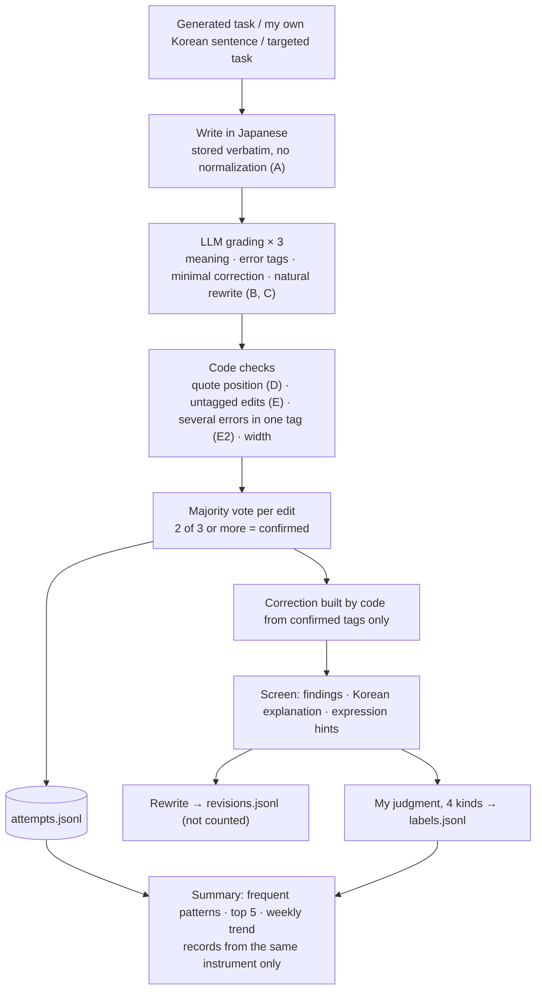

<!-- Source: README_kr.md (Korean is the source; English and Japanese are translations) · synced 2026-10-26 -->

# PragmaticsKR2JP — a Japanese writing coach for Korean speakers

[English](README.md) · [한국어](README_kr.md) · [日本語](README_jp.md)

[](https://github.com/fairyofdata/PragmaticsKR2JP/actions/workflows/tests.yml)

A personal, local app that points out what is wrong in a short piece of Japanese writing against a **fixed error taxonomy**, and lets **code** count which patterns you keep getting wrong.

- **The LLM only annotates**: error position, type, correction and a Korean explanation. Scores, rankings, trends and checking its own output are done by code.
- **Reading a wrong input as what you probably meant** is blocked by code checks, not by polite requests in the prompt.
- **How far those annotations can be trusted is measured and published.** Grammar mode found every planted error position (1.00); expression mode found 0.74–0.93 (12 items, see [experiment](#experiment-summary)).


<sub>Practice screen (captured 2026-09-20). The screen has changed since — the input choice moved into the main column, among others. Retaking it is on hold until the paid re-run.</sub>

## Quick start

```powershell
python -m venv .venv
.venv\Scripts\python -m pip install -r requirements.txt
copy .env.example .env        # put in OPENAI_API_KEY (or GEMINI_API_KEY + LLM_PROVIDER=gemini)
.venv\Scripts\streamlit run app.py
```

- **Practice tab**: choose *generated task*, *my own Korean sentence* or *targeted practice* → write in Japanese → grade → judge each finding → optionally rewrite with the corrections hidden.
- **Summary tab**: frequent error patterns (with a *didn't know only* filter), top 5 types, the weekly trend, and a backlog of findings you have not judged yet. Choose demo samples (`samples/`), your own records (`data/`), or both.
- The bundled demo samples were produced with prompt p1, so the default strict version filter hides them. Switch on **"이전 버전 기록도 포함"** (include older records) in the sidebar to see them.
- **Backup (sidebar)**: download everything as a zip of the original JSONL files and merge a backup back in — imports never overwrite and never duplicate. A separate one-way CSV (one finding per row) opens in Excel for analysis or native-speaker review ([ADR 0014](docs/adr/0014-backup-export-import.md)).
- A streak counter can be switched on in the sidebar (off by default). No quotas, no target scores.

**On your phone** (no deployment — your PC is the server): put `COACH_PASSCODE=<8+ characters>` in `.env`, run `python -m tools.run_mobile`, and open the printed address from a phone on the same Wi-Fi. A plain `streamlit run app.py` is reachable from this PC only ([ADR 0016](docs/adr/0016-ci-tests-mobile-over-lan.md)).

 

## One round



## Why

You can work in Japan, study, listen to podcasts and make Japanese friends, and still have **nobody who tells you, like a teacher, where your Japanese went wrong and what would have been appropriate in that scene.** As long as the meaning comes through, nobody corrects you.
Write `友達を合う` and your reader simply hears `友達に会う` and moves on. Speech recognition is worse: it quietly "fixes" a wrong particle into the phonetically closest right one, so the mistake never reaches you.
Years later you still use ほぼ / ほとんど / 大体 interchangeably, and Korean-shaped phrases (`ストレスを受ける`, `薬を食べる`) are still there.

So there are two goals: **catch the wrong thing as the wrong thing**, and **say what is appropriate for that scene and that listener** — and accumulate both into a number that says what you keep getting wrong.

## Status (October 2026)

| Item | Status |
|---|---|
| One round (task/input → grading → judgment → summary) | Works. 53 tests, CI on every push |
| Real usage records | **None yet.** The features are built but have not been tried in real use |
| Phone access | Phone-size layout checked in an automated browser, the passcode lock in tests. Not yet tried on a real phone |
| Experiment | Results are for prompt p1. The full run for the current p2 waits until the eval set is rebuilt |
| Not there yet | Pasting Japanese you actually wrote; "what if the listener changes" (manager / colleague / friend side by side); speaking |

The grammar and measurement side came first, ahead of the original intent (pragmatics, Japanese you actually used). That gap and the plan are in [ADR 0015](docs/adr/0015-direction-check-mobile-deploy.md).

**Current measurement instrument** — by default only records made with the same instrument are aggregated together.

| Taxonomy | Grading prompt | Grading model | Task model | Record schema (not part of the instrument) |
|---|---|---|---|---|
| v1 | p2 | `gpt-5.6-terra` | `gpt-5.6-luna` | s4 |

## Design principles

### 1. The LLM is an annotator; code does the rest of the measurement

| LLM does | LLM never does | Code does |
|---|---|---|
| Generate tasks; tag error spans and types within a fixed taxonomy; write the correction and the Korean explanation | Scores, level judgments, totals, rankings, trends, checking its own output | Quote verification, silent-edit detection, majority voting, aggregation and ranking, measuring agreement and detection rate |

- We ask for categorical tags, never numeric scores: LLM judges are noisy on open numeric scales and steadier on concrete categorical calls.
- Still, each individual error call **is** an LLM measurement. "We aggregated deterministically, therefore it's objective" would be false. So the reliability (reproducibility) and validity (detection rate) of those annotations are measured and published below.
- By default, only records made with the current **measurement instrument** — taxonomy, grading prompt and model — are aggregated. The storage schema is not part of it, so adding a field never hides your history ([ADR 0012](docs/adr/0012-version-filter-measurement-only.md)). A sidebar toggle can include older records with the same taxonomy; the screen then shows the version mix. Different taxonomies are never mixed.

### 2. Don't get dragged

An LLM is the same kind of probabilistic model as speech recognition: it reads a wrong input as what you probably meant. Blocked with **code checks**, not polite requests in the prompt.

| | Check | What it prevents |
|---|---|---|
| A | Store the answer verbatim, no normalization | Errors disappearing at storage time |
| B | Separate "what you meant" from "what is wrong" in the output | Waving an error through because the meaning is clear |
| C | Separate the minimal correction from the natural rewrite; the correction on screen is **built by code from confirmed tags only** | Correction and polishing blurring together; unconfirmed edits leaking into the correction |
| D | **Verify each quoted span exists verbatim in the answer.** When the same string occurs several times (e.g. 「を」), code picks the position from context fields and the diff, and flags it if still ambiguous | Quoting an already-corrected form; two errors on repeated particles collapsing into one |
| E | **Verify every changed character is covered by some tag** | Silent corrections (surfaced as a warning) |
| E2 | **Detect two or more different words fixed inside one tag** (`友達を合って→友達に会って`) | One error buried inside another |
| F | Measure detection rate on an eval set with planted errors | Turning "it works well" into a number |

Overcorrection — the opposite failure — is measured too: how many tags land on answers that contain no errors. Width differences in punctuation, spaces, digits and Latin letters are never errors; half-width katakana (`ｻｰﾊﾞｰ→サーバー`) is a real orthography error and is kept.

Everything language-specific lives in [coach/lang_ja.py](coach/lang_ja.py), which exposes exactly two functions — `tokenize_chunks` (SudachiPy when installed, a script-based approximation otherwise) and `non_error_diff`. [coach/verify.py](coach/verify.py), voting and aggregation know nothing about Japanese.

### 3. Variance is handled by voting, not temperature

Each answer is graded 3 times. A finding counts as **confirmed** only if the same type overlapping the same span appears in at least 2 of the 3; single-run findings are shown as "low confidence" and excluded from the counts. The summary shows, next to each type, how many findings were unanimous and how many were dropped as low confidence. Code does the merging. There are no fixed few-shot answer examples (they skew topics and types) — only one short contrast pair per type, unrelated to any task.

### 4. A personal learner corpus, not just a checker

Paste a Korean sentence of your own and translate it without a dictionary, or take a generated task. Every confirmed finding gets a one-click judgment — **slip (typo/IME)** / **didn't know** / **unsure** / **the flag is wrong** — appended to `data/labels.jsonl` (records are never edited). "Frequent errors" are counted per *pattern*, not per type: `を → に (会う)` — lemmatized, with the verb a particle hangs on — and only once it recurs in two or more separate attempts.

Typos must not become "your weaknesses". Three layers, none of them an LLM: (1) same reading before and after (`合って/会って`) → IME slip candidate, excluded unless you mark it *didn't know*; (2) a one-off never ranks; (3) your own judgment wins. One-kana slips (`ありがと ございます`) cannot be told apart from particle errors (`を→に`) by code, so they are left to (2) and (3). "The flag is wrong" judgments measure the tool's precision and feed the eval set ([ADR 0010](docs/adr/0010-personal-learner-corpus.md)).

### 5. Closing the learning loop — without polluting the measurement

Corrective feedback works when the learner notices, **repairs it themselves**, and meets it again. Each of these is kept apart from the measurement ([ADR 0013](docs/adr/0013-learning-loop.md)):

- **Rewrite**: hide the corrections, show only *where* and *what type* was wrong, and rewrite. Code checks each spot — fixed / left as is / changed differently — for free. An optional re-grade (~$0.04) finds patterns that were **wrong again after the rewrite**, the strongest sign of a misconception. Rewrites are stored in `data/revisions.jsonl` and never counted, because they were written after seeing the feedback.
- **Targeted practice**: a task built to require one of your frequent or *didn't know* patterns, without hinting at the answer. Targeted attempts are **excluded** from frequent errors, the top 5 and the trend (they deliberately provoke that error) and reported separately as wrong again / used correctly / avoided. "Used correctly" requires the right form directly before the word it attaches to (`に` + `会う`), not just somewhere in the answer.
- **Expression hints**: places the model changed only in the natural rewrite (`その→あの`) are highlighted as hints, not counted. Skipped when the rewrite is effectively a different text (character similarity < 0.6).
- **Weekly trend**: per type, the share of attempts containing it, plus median time — rates, not counts, because practice volume varies ([ADR 0011](docs/adr/0011-weekly-trend.md)).

### 6. Two modes: grammar and expression

Fewer types per decision means better agreement. Errors outside the chosen mode are tagged `OUT_OF_MODE` only and excluded from the ranking.

| Grammar mode (morphosyntax — accuracy) | Shared | Expression mode (lexis & pragmatics — appropriateness) |
|---|---|---|
| particles / conjugation / tense-aspect / voice & benefactives & transitivity / connectives | orthography, typos, IME conversion / other | politeness / register / sentence-final modality / collocation / word choice / discourse |

Every tag also carries a "Korean transfer" flag. Each task carries a medium (email / chat / spoken) and a relationship (client / manager / colleague / friend), and judgments are made for that scene.


## Experiment summary

Twelve answers with planted errors (6 grammar, 6 expression, 2 of them error-free) were graded 3 times each under three conditions (plain instruction / codebook prompt / codebook + 3-way vote). Model `gpt-5.6-terra`; every metric is computed by code. The table is for prompt **p1** (`experiments/results/repro_20260920_032338.json`).

| Condition | Mode | Exact agreement | Span detection | Span + type | Tags on clean answers |
|---|---|---|---|---|---|
| plain | grammar | 0.67 | 1.00 | 0.29 | 0.00 |
| plain | expression | 0.17 | 0.93 | 0.67 | 2.33 |
| guide | grammar | 0.67 | **1.00** | 0.62 | 0.00 |
| guide | expression | 0.50 | 0.81 | 0.78 | 0.67 |
| vote | grammar | 0.67 | **1.00** | 0.58 | 0.00 |
| vote | expression | 0.67 | 0.74 | 0.67 | 1.00 |

- **Grammar mode did not get dragged** (span detection 1.00). Expression mode is lower at 0.74–0.93 — the side the project's name (Pragmatics) points to is the weakest.
- **The codebook prompt clearly beats a plain instruction**: unexpected tags 0.70 → 0.10, tags on clean answers 1.17 → 0.33.
- **3-way voting cannot be judged at this size.** A 0.1 difference is noise with 12 items. It stays the default because it attaches a confidence ("2 of 3") to every tag.
- **Prompt rules were not followed** ("split merged tags" was obeyed once in three runs), so the E2 and width rules moved into code.
- Limitations: the eval set was written by Claude and graded by GPT — not a human gold standard; one label error was found this way. The prompt the app now uses (p2) has not had a full run yet.

Method, metric definitions, the p0 run, per-item analysis and how to run it (in Korean): **[experiments/README.md](experiments/README.md)**

## Cost

`gpt-5.6-terra`: $2 in / $12 out per 1M tokens (2026-09). p1 is computed from the token usage in the result files, p2 from one live check. p2 costs about twice as much (context fields and more reasoning tokens).

| Item | Calls | p1 | p2 (current) |
|---|---|---|---|
| **One grading in the app** (3-way vote) | 3 | ~$0.02 | **~$0.04** |
| Re-grading a rewrite | 3 | — | ~$0.04 |
| One task generation (`gpt-5.6-luna`) | 1 | <$0.001 | <$0.001 |
| One full experiment | 180 | ~$1.2 | ~$1.3 (estimate) |

## Privacy and operation

- Records are stored only as JSONL in `data/` on this PC — git-ignored and append-only (never edited). Backup zips and analysis CSVs are git-ignored too.
- The only thing that leaves the PC is the task and answer text sent to the LLM API (OpenAI or Gemini) for grading and task generation.
- By default the app is reachable from this PC only (`.streamlit/config.toml`). The only way to open it to the network is `tools.run_mobile`, which refuses to start without a passcode. Traffic is not encrypted, so use it at home or over a private network.
- Nothing is deployed. There is no separate backend: one Streamlit process does the UI, the LLM calls and the file storage.
- A personal-information gate (developed separately) will be connected later. Then the original text stays local, and grading and quote checks run on the masked sentence.

## Layout

```
app.py                  Streamlit UI (practice / summary)
coach/taxonomy.py       error taxonomy v1 (order = priority)
coach/prompts.py        task and grading prompts
coach/schemas.py        LLM output and record schema (schema version)
coach/llm.py            the only place that calls an LLM
coach/verify.py         anti-drag checks D, E, E2 (language-agnostic)
coach/lang_ja.py        Japanese layer: word chunking, non-error differences
coach/voting.py         3-way majority voting
coach/stats.py          aggregation (pure functions)
coach/corpus.py         personal corpus: patterns, typo filtering, frequent errors
coach/store.py          JSONL read/write (append-only)
coach/backup.py         backup zip export / merge-import, analysis CSV
experiments/            eval set, experiment script, results (raw model output kept)
tests/                  tests that run without an LLM (run in CI)
tools/run_mobile.py     phone access over the LAN (passcode required)
tools/screenshots.py    README screenshots
tools/session_handoff.py  session handoff hook
docs/adr/               architecture decision records
docs/HANDOFF.md         development session handoff (where work stopped)
.github/workflows/      CI (tests only, no deployment)
samples/                demo samples, synthetic (committed)
data/                   your own records, JSONL, append-only (git-ignored)
```

Tests, experiments and screenshots:

```powershell
.venv\Scripts\python -m pytest -q                    # code checks, voting, aggregation (no API)
.venv\Scripts\python -m experiments.repro            # experiment (~180 API calls)
.venv\Scripts\python -m experiments.build_samples    # regenerate demo samples
.venv\Scripts\python -m tools.screenshots            # regenerate README screenshots
```

## Next steps

**Back to the original intent** ([ADR 0015](docs/adr/0015-direction-check-mobile-deploy.md))
- Japanese you actually wrote: paste it, pick only the scene (medium and listener), and grade. Importing Japanese questions once asked to an in-house Copilot as `source: "imported"` belongs here too
- What if the listener changes: show side by side how the same meaning is said to a manager, a colleague and a friend, and explain the differences

**Measurement**
- Eval set v2: from the user's real translations, labeled typo vs. misconception, reviewed by a native speaker, 30+ items, at least 30% error-free ([ADR 0007](docs/adr/0007-eval-set-from-user-translations.md)) → p2 experiment → update the numbers in this README
- Native-speaker review: once "the flag is wrong" judgments accumulate, measure precision, recall and explanation accuracy from the analysis CSV

**Operation**
- Connect the personal-information gate
- Deployment (server + authentication + budget cap) is reconsidered only after real use shows the app is worth it

**Out of scope for now**
- Speech input: only with recognition that does not language-model-correct the learner's mistakes away (kana-level)
- Scheduled tests, spaced repetition, login
- Dynamic few-shot: retrieve past cases of the same error type once records accumulate

Reasons behind the design and the alternatives that were dropped are in [docs/adr/](docs/adr/README.md).

## License

MIT
