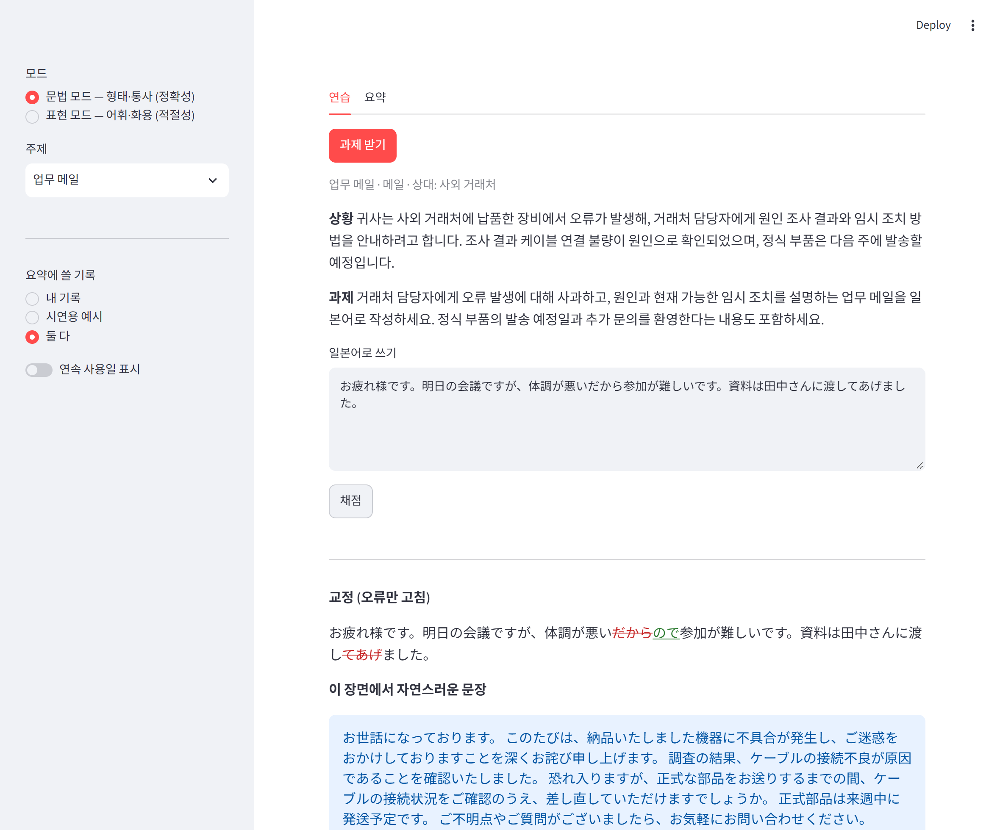
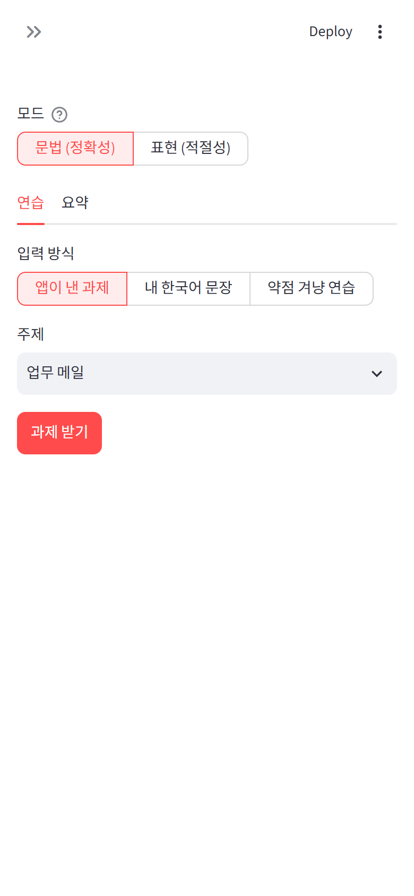
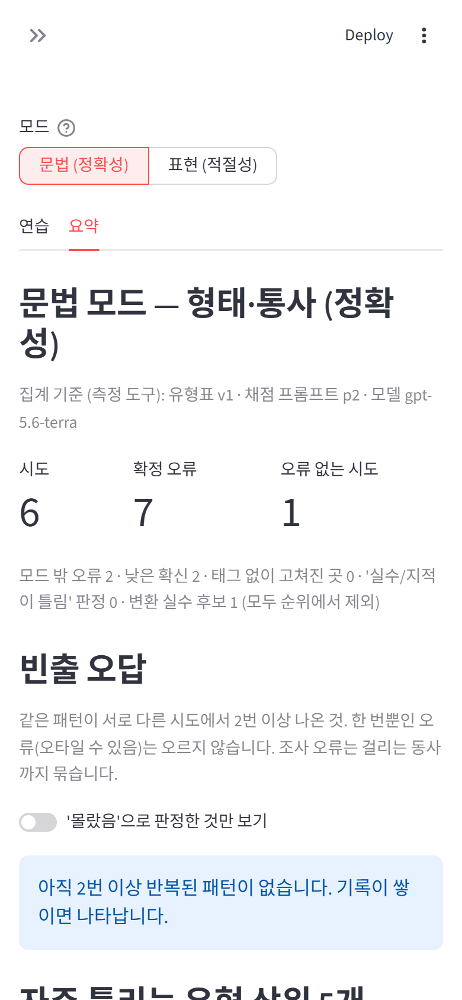
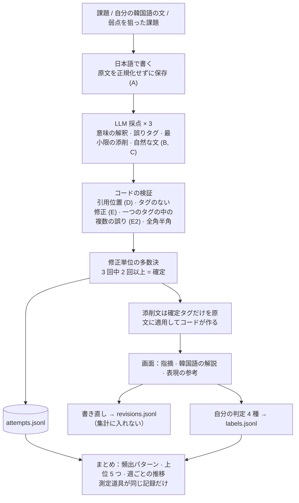
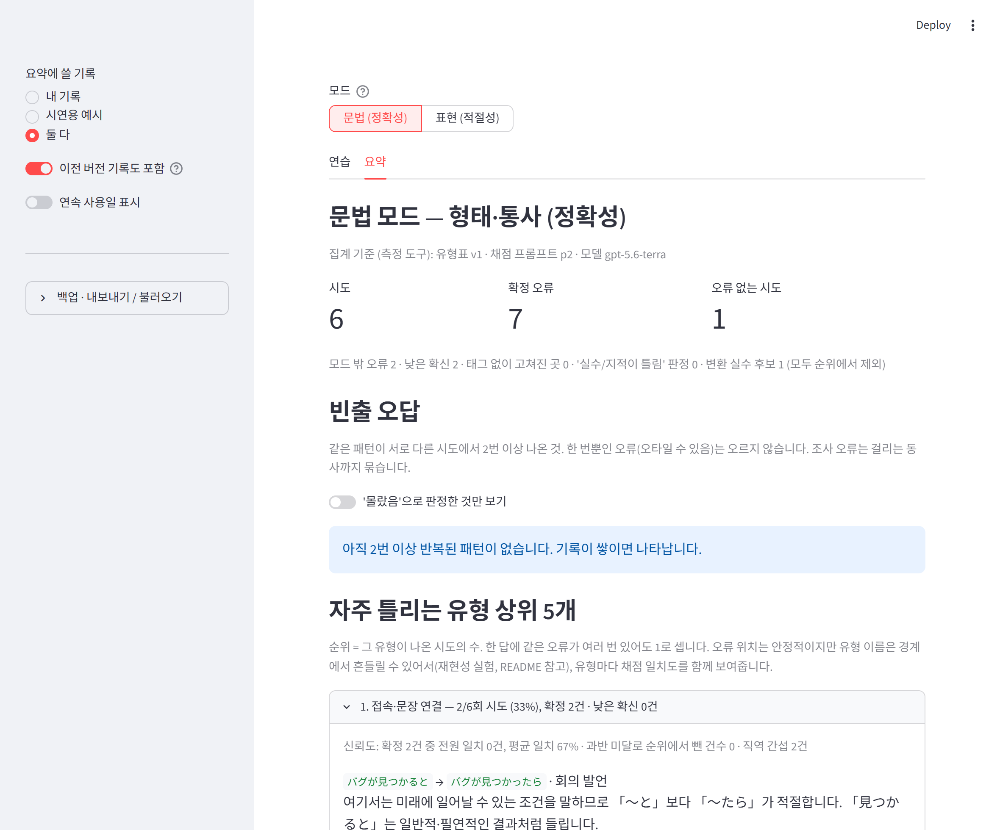

<!-- 原本: README_kr.md（韓国語版が原本、英語・日本語は翻訳） · 同期: 2026-10-26 -->

# PragmaticsKR2JP — 韓国語母語話者のための日本語ライティング・コーチ

[English](README.md) · [한국어](README_kr.md) · [日本語](README_jp.md)

[](https://github.com/fairyofdata/PragmaticsKR2JP/actions/workflows/tests.yml)

日本語で書いた短い文章の誤りを**固定の誤用分類表**に沿って指摘し、自分が繰り返し間違えるパターンを**コードが**数えて見せる、個人用のローカルアプリです。

- **LLM は注釈だけを担当します。** 誤りの位置・種別・添削・韓国語の解説まで。点数、順位、推移、自分の結果の検証はコードが行います。
- **誤った入力を「たぶんこういう意味だろう」と正しく読み替えてしまう**ことを、プロンプトでのお願いではなくコードの検証で防ぎます。
- **その注釈がどこまで信頼できるかを測って公開します。** 文法モードは仕込んだ誤りの位置をすべて検出（1.00）、表現モードは 0.74〜0.93 でした（12 問、[実験](#実験の要約)）。


<sub>練習画面（2026-09-20 撮影）。その後、入力方式の選択が本文に移るなど画面が変わっています。撮り直しは有料の再実験と一緒に行うため保留中です。</sub>

## クイックスタート

```powershell
python -m venv .venv
.venv\Scripts\python -m pip install -r requirements.txt
copy .env.example .env        # OPENAI_API_KEY（または GEMINI_API_KEY + LLM_PROVIDER=gemini）を記入
.venv\Scripts\streamlit run app.py
```

- **練習タブ**：「アプリが出す課題」／「自分の韓国語の文」／「弱点を狙った練習」を選択 → 日本語で書く → 採点 → 指摘ごとに判定 → 添削を隠して書き直し（任意）
- **まとめタブ**：頻出の誤りパターン（「知らなかった」のみの絞り込み）、種別の上位 5 つ、週ごとの推移、まだ判定していない指摘の一覧。デモ用サンプル（`samples/`）と自分の記録（`data/`）を選んで見られます。
- 同梱のデモ用サンプルはプロンプト p1 で作ったため、既定（厳密）のバージョンフィルタではまとめに表示されません。サイドバーの **「이전 버전 기록도 포함」**（以前のバージョンの記録も含める）をオンにすると表示されます。
- **バックアップ（サイドバー）**：記録全体を元の JSONL ファイルのまま zip でダウンロードし、バックアップを再び統合できます。読み込みは上書きせず、重複も作りません。分析用 CSV（指摘 1 件 = 1 行）は書き出し専用で、Excel で開いたりネイティブのチェックに回したりするときに使います（[ADR 0014](docs/adr/0014-backup-export-import.md)）。
- 連続使用日数の表示はサイドバーでオンにできます（既定はオフ）。ノルマや目標点はありません。

**スマホで使う**（デプロイなし、自分の PC がサーバー）：`.env` に `COACH_PASSCODE=<8文字以上>` を入れて `python -m tools.run_mobile` を実行し、同じ Wi-Fi のスマホから表示されたアドレスにアクセスします。普通に `streamlit run app.py` するとこの PC からしかアクセスできません（[ADR 0016](docs/adr/0016-ci-tests-mobile-over-lan.md)）。

 

## 一巡の流れ



## なぜ作ったか

日本で会社に勤め、勉強し、ポッドキャストを聞き、日本人の友達ができても、**「自分の日本語がどこでどう間違っていて、その場面で何が適切だったのかを、先生のように教えてくれる人」はいません。** 意味さえ通じれば、誰も指摘しないからです。
`友達を合う`と書いても、相手は`友達に会う`と受け取って流してしまいます。音声認識はもっと厄介で、間違った助詞を発音の近い正しい助詞に「気を利かせて」直してしまうので、誤りに気づく機会がありません。
その結果、ほぼ／ほとんど／大体 を区別せずに使い続けたり、韓国語をそのまま訳した表現（`ストレスを受ける`、`薬を食べる`）が何年も直らなかったりします。

そこで目標は二つです。**間違いを間違いのまま捉えること**、そして**その場面・その相手に何が適切かを伝えること**。それを積み重ねて、「自分が何を繰り返し間違えるか」を数字で見えるようにすることです。

## 現在の状態（2026年10月）

| 項目 | 状態 |
|---|---|
| 一巡（出題・入力 → 採点 → 判定 → まとめ） | 動作します。テスト 53 個、push ごとに CI |
| 実際の使用記録 | **まだ 0 件。** 機能はそろっていますが、実際に使って確かめたことはまだありません |
| スマホからのアクセス | スマホサイズの画面は自動ブラウザで、パスコードのロックはテストでのみ確認。実機では未確認 |
| 実験 | 結果はプロンプト p1 のもの。現在の p2 の本実験は評価セットを作り直してから行います |
| まだないもの | 実際に書いた日本語を貼り付ける入力、「相手が変わったら」（上司・同僚・友達の対比）、話すこと |

当初の企画（語用論、実際に使った日本語）より、文法・測定の側が先にそろいました。このずれと次の順序は [ADR 0015](docs/adr/0015-direction-check-mobile-deploy.md) に書いています。

**現在の測定道具** — 既定では、これが同じ記録だけを一緒に集計します。

| 分類表 | 採点プロンプト | 採点モデル | 出題モデル | 記録形式（測定道具ではない） |
|---|---|---|---|---|
| v1 | p2 | `gpt-5.6-terra` | `gpt-5.6-luna` | s4 |

## 設計方針

### 1. LLM は注釈者。測定の残りはコードが行う

| LLM がやること | LLM に任せないこと | コードがやること |
|---|---|---|
| 課題の出題、固定分類表内での誤用箇所・種別のタグ付け、添削文、韓国語の解説 | 点数、レベル判定、累計・順位・傾向、自分の出力の検証 | 引用の検証、タグなし修正の検出、多数決、集計と順位付け、一致率・検出率の測定 |

- 数値の点数ではなく範疇タグだけを受け取ります。LLM 判定者は自由な数値尺度では揺れが大きく、具体的な範疇判断のほうが安定するという報告があるためです。
- ただし誤用一つひとつの判断は、やはり LLM による測定です。「決定的に集計したから客観的」とは言えません。そこで注釈の信頼性（再現性）と妥当性（検出率）を測り、下に公開しています。
- 既定では、**測定ツール**（分類表・採点プロンプト・モデル）が現在と同じ記録だけを集計します。保存形式であるスキーマは含めないので、項目を追加しても蓄積した記録は消えません（[ADR 0012](docs/adr/0012-version-filter-measurement-only.md)）。サイドバーの切り替えで分類表が同じ以前の記録を含めることができ、その場合は混在したバージョン構成を画面に表示します。分類表が異なる記録は決して混ぜません。

### 2. 引きずられない

LLM も音声認識と同じ確率モデルで、誤った入力を「たぶんこういう意味だろう」と正しく読んでしまいます。これをプロンプトでのお願いではなく、**コードの検証**で防ぎます。

| | 仕組み | 防ぐもの |
|---|---|---|
| A | 入力を正規化せずそのまま保存 | 保存の段階で誤用が消えること |
| B | 「何を言いたかったか」と「どこが誤りか」を分けて出力させる | 意味が通るからと見逃すこと |
| C | 最小限の添削文と、場面に合った自然な文を分ける。画面の添削文は**確定したタグだけを原文に適用してコードが作る** | 添削と推敲が混ざって誤用がぼやけること、確定していない修正が添削文に混ざること |
| D | **タグの引用が原文に一字一句あるかをコードが検証。** 同じ文字列（例：「を」）が複数回出る場合は、文脈フィールドと差分から位置をコードが決め、それでも曖昧なら警告 | すでに直した形で引用すること、繰り返される助詞の誤り 2 件が 1 件にまとめられること |
| E | **原文→添削文で変わった文字がすべてタグで覆われているかを検証** | 黙って直すこと（画面に警告を表示） |
| E2 | **一つのタグの中で別々の語が 2 つ以上直されていないか検出**（`友達を合って→友達に会って`） | ある誤用が別の誤用に埋もれること |
| F | 誤用を仕込んだ評価セットで検出率を測定 | 「よく拾える」を数字にすること |

逆方向の失敗（過剰添削）も測ります。誤用のない答えにタグが何個つくかです。なお句読点・空白・数字・英字の全角半角の違いだけの修正は誤りとして扱いませんが、半角カタカナ（`ｻｰﾊﾞｰ→サーバー`）は実際の表記の誤りとして残します。

日本語に関する知識は [coach/lang_ja.py](coach/lang_ja.py) だけに置き、外には 2 つの関数しか出しません。`tokenize_chunks`（SudachiPy があれば形態素解析、なければ表記ベースの近似）と `non_error_diff` です。[coach/verify.py](coach/verify.py)、多数決、集計は日本語を一切知りません。

### 3. 揺れは temperature ではなく多数決で

同じ答えを 3 回採点し、同じ種別かつ位置が重なる指摘が 2 回以上出たものだけを**確定**とします。1 回だけのものは「参考（確信度低）」として画面に出すだけで、集計には入れません。まとめ画面では種別ごとに、全会一致の件数と確信度が低く除外した件数も表示します。まとめるのはコードです。答え全体を見せる固定 few-shot は入れません（主題と種別が偏るため）。種別ごとに課題と無関係な短い対比ペアを 1 つだけ置いています。

### 4. チェッカーではなく、個人の学習者コーパス

自分で用意した韓国語の文を辞書なしで日本語にするか、アプリが出す課題に答えます。確定した指摘ごとに **うっかり（誤字・変換）／知らなかった／どちらとも言えない／指摘が間違い** のどれかを押すと、`data/labels.jsonl` に 1 行追記されます（試行の記録そのものは書き換えません）。よくある誤りは種別ではなく**パターン**単位で数えます。`を → に (会う)` のように基本形にそろえ、助詞はかかる動詞までまとめ、**別々の試行で 2 回以上**出たものだけが上がります。

誤字が「自分の弱点」になってはいけません。ふるい分けは 3 段階で、どれも LLM ではありません。① 修正前後の読みが同じなら（`合って/会って`）変換ミス候補として外し、「知らなかった」を押せば数えます。② 1 回だけの誤りは上がりません。③ 本人の判定が最終です。かな 1 文字の誤字（`ありがと ございます`）は助詞の誤り（`を→に`）とコードでは区別できないため、②と③に任せます。「指摘が間違い」の判定はツールの精度を測る材料になり、評価セットの候補になります（[ADR 0010](docs/adr/0010-personal-learner-corpus.md)）。

### 5. 学習のサイクル — 測定を汚さずに

訂正フィードバックは、学習者が気づき、**自分で書き直し**、もう一度出会うときに効きます。どれも入れますが、測定とは分けます（[ADR 0013](docs/adr/0013-learning-loop.md)）。

- **書き直し**：添削は隠し、誤りの*位置*と*種別*だけを見せて書き直します。位置ごとに「直した／そのまま／別の形に直した」をコードで確認（無料）。任意で再採点（約 $0.04）すると、**書き直しても同じ誤りが出たパターン**がわかります。これが思い込みの最も強いサインです。書き直しはフィードバックを見た後なので `data/revisions.jsonl` に別に保存し、集計には入れません。
- **弱点ねらいの練習**：よくある誤りや「知らなかった」パターンを使わざるを得ない課題。答えは匂わせません。その誤りをわざと引き出すため、よくある誤り・上位 5 件・推移からは**外し**、「また間違えた／正しく使えた／使わなかった」として別に表示します。「正しく使えた」は、正しい形がかかる語の直前に続けて出たときだけ認めます（`に` + `会う`）。
- **表現の参考**：自然な文でだけ変えられた箇所（`その→あの`）を強調表示します。集計外。実質的に書き直した文（文字の類似度 0.6 未満）なら省略します。
- **週ごとの推移**：種別ごとに「その種別が出た試行の割合」と所要時間の中央値。練習量が週ごとに違うので件数ではなく割合です（[ADR 0011](docs/adr/0011-weekly-trend.md)）。

### 6. 2 つのモード（文法 / 表現）

一度に選ぶ種別を減らすと一致率が上がります。選んだモード外の誤用は `OUT_OF_MODE` とだけタグ付けし、順位からは外します。

| 文法モード（形態・統語：正確さ） | 共通 | 表現モード（語彙・語用：適切さ） |
|---|---|---|
| 助詞 / 活用 / テンス・アスペクト / 態・授受・自他動詞 / 接続 | 表記・誤字・変換ミス / その他 | 敬語・丁寧体 / 文体・場面適合 / 文末表現 / 連語・慣用 / 語彙選択 / 文章構成・談話 |

すべてのタグに「韓国語直訳の干渉」フラグが付きます。課題には媒体（メール / チャット / 口頭）と相手との関係（社外 / 上司 / 同僚 / 友人）が設定され、判定はその場面を基準に行います。



## 実験の要約

誤りを仕込んだ答え 12 件（文法 6、表現 6、うち誤りなし 2）を、三つの条件（単純な指示 / 詳細な指針 / 詳細な指針 + 3 回多数決）でそれぞれ 3 回ずつ採点しました。モデルは `gpt-5.6-terra`、指標はすべてコードが計算します。下はプロンプト **p1** の結果です（`experiments/results/repro_20260920_032338.json`）。

| 条件 | モード | 完全一致 | 位置の検出率 | 種別まで一致 | 誤りなしの答えへのタグ |
|---|---|---|---|---|---|
| plain | 文法 | 0.67 | 1.00 | 0.29 | 0.00 |
| plain | 表現 | 0.17 | 0.93 | 0.67 | 2.33 |
| guide | 文法 | 0.67 | **1.00** | 0.62 | 0.00 |
| guide | 表現 | 0.50 | 0.81 | 0.78 | 0.67 |
| vote | 文法 | 0.67 | **1.00** | 0.58 | 0.00 |
| vote | 表現 | 0.67 | 0.74 | 0.67 | 1.00 |

- **文法モードは引きずられませんでした**（位置の検出率 1.00）。表現モードは 0.74〜0.93 と低く、プロジェクト名（Pragmatics）が指す側がいちばん弱いことになります。
- **詳細な指針は単純な指示より明らかに良い**：想定外のタグ 0.70 → 0.10、誤りなしの答えへのタグ 1.17 → 0.33。
- **3 回多数決の効果はこの規模では判断できません。** 12 問で 0.1 の差は雑音です。タグごとに「3 回中何回」という確信度が付くので、既定のままにしています。
- **プロンプトの規則は守られませんでした**（「タグを分ける」は 3 回中 1 回）。そこで E2 と全角半角の規則をコードに移しました。
- 限界：評価セットは Claude が書き GPT が採点しました。人が作った正解ではなく、実際にラベルの誤りを 1 件見つけています。いまアプリが使う p2 では、まだ本実験をしていません。

方法、指標の定義、p0 の結果、問題ごとの分析、実行方法（韓国語）：**[experiments/README.md](experiments/README.md)**

## コスト

`gpt-5.6-terra`：入力 $2 / 出力 $12（100 万トークンあたり、2026-09 時点）。p1 は実験結果ファイルのトークン使用量から、p2 は実際の確認 1 件から計算しました。p2 は文脈フィールドと推論トークンが増えて約 2 倍です。

| 項目 | 呼び出し数 | p1 | p2（現在） |
|---|---|---|---|
| **アプリでの採点 1 回**（3 回多数決） | 3 | 約 $0.02 | **約 $0.04（約 6 円）** |
| 書き直しの再採点 | 3 | — | 約 $0.04 |
| 出題 1 回（`gpt-5.6-luna`） | 1 | $0.001 未満 | $0.001 未満 |
| 実験 1 回分 | 180 | 約 $1.2 | 約 $1.3（見込み） |

## 個人情報と運用

- 記録はこの PC の `data/` に JSONL としてのみ保存します。git の対象外で、追記のみ（書き換えない）です。バックアップの zip と分析用 CSV も git の対象外にしています。
- 外に出るのは、採点・出題のときに LLM API（OpenAI または Gemini）へ送る課題と答えの文だけです。
- 既定ではこの PC からしかアクセスできません（`.streamlit/config.toml`）。ネットワークに開く手段は `tools.run_mobile` だけで、パスコードがないと起動を拒否します。通信は暗号化されないため、自宅かプライベートネットワークでのみ使います。
- デプロイはしていません。別のバックエンドはなく、Streamlit のプロセス一つが画面・LLM 呼び出し・ファイル保存をすべて担います。
- 個人情報ゲート（別途開発中）と連携する予定です。その際は原文をローカルに置き、採点と引用の検証はマスクした文で行います。

## 構成

```
app.py                  Streamlit の画面（練習 / まとめ）
coach/taxonomy.py       誤用分類表 v1（順序 = 優先度）
coach/prompts.py        出題・採点プロンプト
coach/schemas.py        LLM 出力・記録の形式（スキーマのバージョン）
coach/llm.py            LLM を呼ぶ唯一の場所（ここだけ替えれば提供元を交換）
coach/verify.py         引きずられない検証 D・E・E2（言語非依存）
coach/lang_ja.py        日本語専用：語の区切り、誤りではない差の判定
coach/voting.py         3 回採点の多数決
coach/stats.py          集計（純粋関数）
coach/corpus.py         個人コーパス：パターン、タイプミスの除外、頻出の誤り
coach/store.py          JSONL の読み書き（追記のみ）
coach/backup.py         バックアップ zip の書き出し・読み込み（統合）、分析用 CSV
experiments/            評価セット、実験スクリプト、結果（モデルの生応答を保存）
tests/                  LLM なしで動くテスト（CI で実行）
tools/run_mobile.py     同じネットワークからのスマホ接続（パスコード必須）
tools/screenshots.py    README のスクリーンショット生成
tools/session_handoff.py  セッション引き継ぎのフック
docs/adr/               設計判断の記録（なぜこう作ったか）
docs/HANDOFF.md         開発セッションの引き継ぎ（いま止まっている地点）
.github/workflows/      CI（テストのみ、デプロイなし）
samples/                デモ用の合成サンプル（コミット済み）
data/                   実際の記録 JSONL（git 対象外、追記のみ）
```

テスト・実験・スクリーンショット：

```powershell
.venv\Scripts\python -m pytest -q                    # LLM なしで検証・多数決・集計をテスト
.venv\Scripts\python -m experiments.repro            # 再現性・検出率の実験（API 呼び出し約 180 回）
.venv\Scripts\python -m experiments.build_samples    # デモ用サンプルの再生成
.venv\Scripts\python -m tools.screenshots            # README のスクリーンショット再生成
```

## 次にやること

**当初の企画に戻す**（[ADR 0015](docs/adr/0015-direction-check-mobile-deploy.md)）
- 実際に書いた日本語を入れる：日本語を貼り付けて場面（媒体・相手）だけ選べば採点。社内 Copilot に投げた日本語の質問を `source: "imported"` として取り込むのもここに含めます
- 相手が変わったら：同じ内容を上司・同僚・友達にそれぞれどう言うかを並べて見せ、違いを説明

**測定**
- 評価セット v2：ユーザーの実際の翻訳から、タイプミス／誤解の区別、ネイティブのチェック、30 件以上、誤りなし 30% 以上（[ADR 0007](docs/adr/0007-eval-set-from-user-translations.md)）→ p2 実験 → この README の数値を更新
- ネイティブのチェック：「指摘が誤り」の判定がたまったら、分析用 CSV で精度・再現率・解説の正確さを測る

**運用**
- 個人情報ゲートとの連携
- デプロイ（サーバー + 認証 + 予算上限）は、実際に使って役に立つと確かめてから再検討

**いまは範囲外**
- 音声入力：言語モデルによる補正をせず、かな単位で認識する方式でなければこのアプリの目的に合いません
- 定期テスト、復習スケジューラー、ログイン
- 記録がたまったら「同じ種別の過去の事例」を探して例として入れる動的 few-shot

設計判断の理由と捨てた案は [docs/adr/](docs/adr/README.md) にあります。

## ライセンス

MIT
